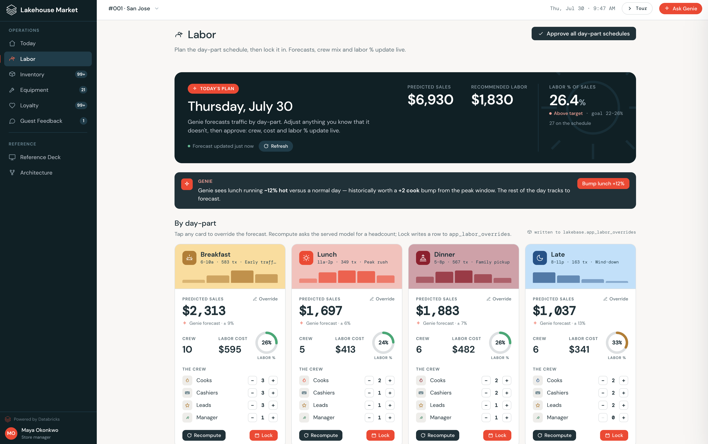

# Lakehouse Market · Homebase

A Databricks App: a store manager's daily operations console for a fictional QSR, built end to end on the lakehouse. One synthetic dataset, real Lakebase write-back on every action, Genie chat from a slide-over, and an in-app labor recommendation from a UC-trained model.

**Modules:** Today · Labor · Inventory · Equipment · Loyalty · Guest Feedback.



## Architecture

```
React + Vite UI  ->  FastAPI (uvicorn)  ->  UC reads (SQL warehouse)
                                         ->  Lakebase Postgres (writes)
                                         ->  Genie space (chat)
```

The app reads governed data from Unity Catalog, writes every manager action to a Lakebase Postgres instance, and answers natural-language questions through a Genie space. Full internals: [docs/architecture.md](docs/architecture.md).

## Quick start

Deploy to a fresh workspace:

```bash
make setup
```

This resolves a SQL warehouse, deploys the bundle (app + Lakebase instance + init job), grants the App service principal UC access, and runs the init job (data generation, scoring, and Genie space creation). Takes about 10 to 15 minutes, most of it the init job.

Retarget any workspace by editing the variable defaults in `databricks.yml` (or passing `--var catalog=... --var schema=...`). Nothing else needs editing.

Redeploy after UI or code changes only:

```bash
make build && databricks bundle deploy && databricks bundle run homebase
```

**Prereqs:** `databricks` CLI v0.230+ (authenticated), `uv`, Node 20+, `jq`.

## Local dev

```bash
make install
cp .env.example .env    # fill in DATABRICKS_HOST, WAREHOUSE_ID, TOKEN
make dev                 # UI on :5173 (proxies /api -> :8000), FastAPI on :8000
make test
```

## What's inside

| Module | Route | Writes to |
|---|---|---|
| Today | `/today` | (read only) |
| Labor | `/labor` | `app_labor_overrides` |
| Inventory | `/inventory` | `app_purchase_orders` |
| Equipment | `/equipment` | `app_work_orders` |
| Loyalty | `/members` | `app_offer_pushes` |
| Guest Feedback | `/feedback` | `app_review_responses` |

## What's intentionally not here

Real PII (all data synthetic), production auth (uses the App service principal), mobile (desktop only), and production-grade ML (models are demo grade).

Powered by Databricks: Lakebase + Genie + Unity Catalog + Apps.
